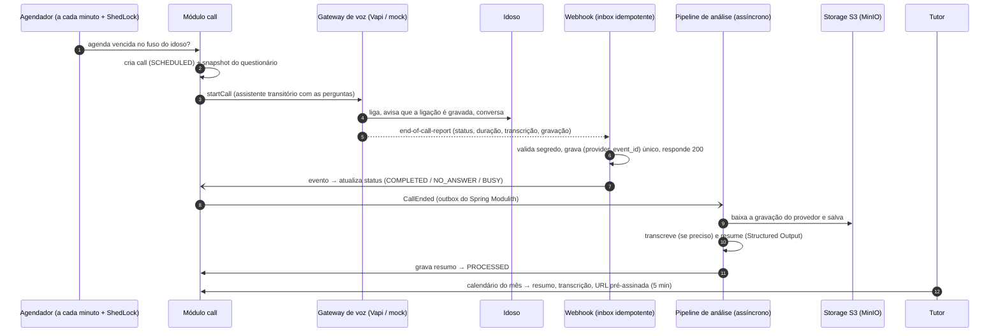

# Cuida — backend

Backend do MVP de **monitoramento conversacional diário de pessoas idosas**. O sistema liga todos
os dias para a pessoa idosa, conversa por voz com IA, grava, transcreve, gera um resumo estruturado
e mostra tudo ao **tutor** (filho, sobrinho, cuidador) em um **calendário**.

> **agenda → liga → conversa → grava → transcreve → salva → resume → exibe no calendário**

Para cada dia, o tutor vê o **resumo** (respostas às perguntas que ele configurou, observações
gerais e nível de alerta), a **transcrição completa** e o **áudio** da ligação.

> **Status:** em construção, entregue em 7 fases. Concluída: **Fase 1 (fundação)**. Este README é
> completado a cada fase.

| Fase | Conteúdo | Status |
|---|---|---|
| 1 | Fundação: projeto, módulos, Flyway, Testcontainers, CI | ✅ |
| 2 | Segurança (JWT, papéis, ownership), formato de erros, Swagger | ✅ |
| 3 | Cadastros: idosos, agenda, questionário, consentimento | ✅ |
| 4 | Agendamento e telefonia (mock), ShedLock, retentativas, webhook idempotente | ✅ |
| 5 | Pipeline de IA e áudio (S3/MinIO, transcrição, resumo, Resilience4j) | ✅ |
| 6 | Leitura para o tutor: calendário, detalhe, transcrição, áudio, auditoria | ⏳ |
| 7 | Adaptador Vapi, retenção/LGPD, README final, coleção `.http` | ⏳ |

---

## Sumário

- [Fluxo](#fluxo)
- [Arquitetura](#arquitetura)
- [Stack](#stack)
- [Como rodar localmente](#como-rodar-localmente)
- [Variáveis de ambiente](#variáveis-de-ambiente)
- [Testes](#testes)
- [Estrutura de pastas](#estrutura-de-pastas)
- [Decisões técnicas (ADRs)](#decisões-técnicas-adrs)
- [Questões em aberto para discutirmos](#questões-em-aberto-para-discutirmos)

---

## Fluxo



## Arquitetura

O código é organizado **por funcionalidade** (package by feature). Cada subpacote de `br.com.cuida`
é um **módulo do Spring Modulith**, com tudo de que precisa (controller, DTOs, serviço, entidade,
repositório, eventos). As classes são package-private por padrão. Módulos se comunicam apenas por
**fachadas públicas** ou **eventos de domínio**. O build quebra se houver ciclo, acesso a classe
interna de outro módulo ou dependência não declarada (`ModularityTests`).

| Módulo | Responsabilidade | Pode depender de |
|---|---|---|
| `auth` | registro, login, JWT, papéis | `shared` |
| `elderly` | cadastro do idoso, consentimento, exclusão LGPD | `shared` |
| `schedule` | agenda de ligações | `shared`, `elderly` |
| `questionnaire` | perguntas/atributos e snapshot | `shared`, `elderly` |
| `call` | ciclo de vida da ligação, agendador, porta `VoiceCallGateway` (+ `vapi/`, `mock/`) | `shared`, `elderly`, `schedule`, `questionnaire`, `webhook` |
| `webhook` | recepção idempotente (`webhook_events`) | `shared` |
| `analysis` | transcrição e resumo com IA, pipeline pós-ligação | `shared`, `call`, `recording` |
| `recording` | armazenamento de áudio (S3), URL pré-assinada, retenção | `shared`, `call`, `elderly` |
| `calendar` | leitura do tutor: calendário, detalhe, transcrição, áudio | `shared`, `call`, `elderly`, `recording`, `audit` |
| `audit` | log de acesso a dados sensíveis | `shared` |
| `shared` | segurança, web/erros, OpenAPI, config, persistência, logging | nenhum |

```mermaid
flowchart LR
    auth --> shared
    elderly --> shared
    schedule --> elderly
    questionnaire --> elderly
    call --> elderly & schedule & questionnaire & webhook
    analysis --> call & recording
    recording --> call & elderly
    calendar --> call & elderly & recording & audit
    webhook --> shared
    audit --> shared
```

Os diagramas gerados pelo Modulith (PlantUML/AsciiDoc) ficam em [`docs/modules/`](docs/modules)
e são regenerados a cada `./mvnw verify`.

**Telefonia por portas e adaptadores.** A conversa em tempo real **não** passa pelo servidor Java.
Ela é delegada a um gateway de voz gerenciado (padrão: **Vapi**), atrás da porta `VoiceCallGateway`.
No perfil `dev`/`test`, o `MockVoiceCallGateway` simula a ligação e dispara o mesmo fluxo do
webhook. Por isso o projeto roda de ponta a ponta **sem nenhuma chave externa**.

## Stack

| Item | Versão |
|---|---|
| Java | 21 (LTS) |
| Spring Boot | 4.1.1 (Spring Framework 7.0.9, Spring Security 7.1, Hibernate 7.4, Jackson 3.1) |
| Spring AI | 2.0.1 (OpenAI: transcrição + Structured Output) |
| Spring Modulith | 2.1.1 |
| Banco | PostgreSQL 16 + Flyway 12 (`ddl-auto=validate`) |
| Armazenamento | S3 compatível: MinIO (imagem Chainguard) + AWS SDK v2 |
| Resiliência / jobs | Resilience4j 2.4, ShedLock 7.10 |
| Documentação da API | springdoc-openapi 3.1 (Swagger UI com Bearer) |
| Testes | JUnit 6, Spring Boot Test, Testcontainers 2.0, MockMvc |
| Build | Maven Wrapper 3.9.16, Spotless (google-java-format), GitHub Actions |

## Como rodar localmente

**Pré-requisitos:** JDK 21 e Docker (com Compose v2).

> Nesta máquina de desenvolvimento, o `java` padrão é o 17 e `/usr/lib/jvm/java-21-openjdk` é
> só JRE. Use o Temurin 21 do SDKMAN (`sdk env` lê o `.sdkmanrc`) ou exporte
> `JAVA_HOME=$HOME/.sdkman/candidates/java/21.0.12+1.1-tem`. O build falha cedo (enforcer) com
> JDK < 21.

```bash
cp .env.example .env              # opcional: os defaults do perfil dev já funcionam
docker compose up -d              # Postgres 16 + MinIO + criação do bucket
./mvnw spring-boot:run            # perfil dev é o padrão (adaptadores mock, sem chaves)
curl localhost:8080/actuator/health
```

- Console do MinIO: <http://localhost:9001> (usuário/senha de `MINIO_ROOT_USER`/`MINIO_ROOT_PASSWORD`).
- Aplicação em container: `docker compose --profile app up -d --build`.
- Swagger UI: `http://localhost:8080/swagger-ui.html` (a partir da fase 2).
- Requisições prontas: pasta [`http/`](http), no formato do HTTP Client do IntelliJ.

**Como testar uma ligação mock** e **uma ligação real (Vapi)**: documentado nas fases 4 e 7.

## Variáveis de ambiente

Todas estão em [`.env.example`](.env.example). Nenhum segredo fica no código. O `.env` é lido pelo
`docker compose` e pela aplicação (`spring.config.import=optional:file:.env[.properties]`), e
**não é versionado**.

| Variável | Uso | Fase |
|---|---|---|
| `DB_NAME`, `DB_USERNAME`, `DB_PASSWORD`, `DB_PORT`, `DB_URL` | PostgreSQL (no `prod`, `DB_URL`/`DB_USERNAME`/`DB_PASSWORD` são obrigatórias) | 1 |
| `MINIO_ROOT_USER`, `MINIO_ROOT_PASSWORD`, `S3_*` | storage S3 / MinIO | 1 / 5 |
| `JWT_SECRET`, `JWT_TTL`, `APP_BOOTSTRAP_ADMIN_*` | autenticação | 2 |
| `OPENAI_API_KEY`, `OPENAI_*_MODEL`, `APP_TRANSCRIPTION_MODE` | IA (vazio = mocks) | 5 |
| `VAPI_API_KEY`, `VAPI_PHONE_NUMBER_ID`, `VAPI_WEBHOOK_SECRET`, `VAPI_WEBHOOK_BASE_URL` | gateway de voz | 7 |
| `APP_RETENTION_AUDIO_DAYS`, `APP_RETENTION_WEBHOOK_PAYLOAD_DAYS` | retenção LGPD | 7 |

**Perfis:** `dev` (padrão, mocks e infraestrutura local), `test` (Testcontainers) e `prod` (todas
as variáveis obrigatórias, logs JSON). A partir das fases 5 e 7 entram `openai` e `vapi`, que podem
ser combinados (ex.: `dev,vapi`).

## Testes

```bash
./mvnw verify          # unitários (Surefire) + integração *IT (Failsafe) + Spotless + Modulith
./mvnw spotless:apply  # formata o código (google-java-format)
```

- Os testes de integração sobem um **PostgreSQL 16 real via Testcontainers**. Não usamos H2.
- `ModularityTests` verifica os módulos e gera `docs/modules/`. `ArchitectureTests` proíbe
  pacotes por camada técnica e qualquer dependência de `shared` para features.
- A CI (`.github/workflows/ci.yml`) roda o mesmo `./mvnw verify` no Ubuntu com Java 21.

## Estrutura de pastas

```
.
├── .github/                 CI, Dependabot, template de PR
├── .mvn/ mvnw mvnw.cmd      Maven Wrapper (3.9.16, checksum fixado)
├── docs/
│   ├── adr/                 decisões de arquitetura
│   └── modules/             documentação gerada pelo Spring Modulith
├── http/                    requisições .http (IntelliJ HTTP Client)
├── src/main/java/br/com/cuida/
│   ├── CuidaApplication.java
│   ├── auth/ elderly/ schedule/ questionnaire/
│   ├── call/ (vapi/, mock/)  webhook/  analysis/  recording/
│   ├── calendar/  audit/
│   └── shared/ (security/, web/, openapi/, config/, persistence/, logging/)
├── src/main/resources/
│   ├── application.yml, application-{dev,prod}.yml
│   └── db/migration/        migrations Flyway (V1 = esquema completo)
├── src/test/java/br/com/cuida/   espelha os módulos + testsupport/
├── docker-compose.yml  Dockerfile  .env.example
└── pom.xml
```

## Decisões técnicas (ADRs)

| ADR | Decisão |
|---|---|
| [0001](docs/adr/0001-package-by-feature-com-spring-modulith.md) | Package by feature + Spring Modulith |
| [0002](docs/adr/0002-gateway-de-voz-gerenciado.md) | Gateway de voz gerenciado (Vapi) atrás de uma porta |
| [0003](docs/adr/0003-jsonb-para-resumo-estruturado.md) | JSONB para o resumo e o snapshot do questionário |
| [0004](docs/adr/0004-jwt-stateless.md) | JWT stateless (HS256) |
| [0005](docs/adr/0005-processamento-assincrono-com-event-publication-registry.md) | Processamento assíncrono com o Event Publication Registry (outbox) |
| [0006](docs/adr/0006-spring-boot-4-e-spring-ai-2.md) | Spring Boot 4.1 + Spring AI 2.0 |

---

## Questões em aberto para discutirmos

Esta seção reúne **(A)** as decisões que tomei por conta própria quando havia dúvida e **(B)**
tudo o que, na minha avaliação, merece atenção antes de o produto ir para pessoas reais. Cada item
está marcado com a prioridade sugerida: 🔴 alta (bloqueia uso real), 🟡 média, 🟢 baixa.

### A. Decisões tomadas por conta própria (revisar)

| # | Dúvida | O que decidi | Por quê / alternativa |
|---|---|---|---|
| A1 | Versão da stack | **Spring Boot 4.1.1 + Spring AI 2.0.1 + Modulith 2.1.1**. Isso traz **Hibernate 7.4 e Spring Security 7.1**, não 6/6 como no briefing. | O Boot 3.5 está fora do suporte OSS desde 30/06/2026, e o Spring AI 2.0 declara suporte ao Boot 4.0/4.1. Alternativa: Boot 3.5.16 + Spring AI 1.1.8, sem patches de segurança OSS. ([ADR 0006](docs/adr/0006-spring-boot-4-e-spring-ai-2.md)) |
| A2 | Imagem do MinIO | **`cgr.dev/chainguard/minio` + `minio-client`, fixadas por digest.** | A MinIO parou de publicar as imagens oficiais em out/2025 (`minio/minio` não baixa mais). As imagens gratuitas da Chainguard só têm a tag `latest`, por isso o digest. Alternativas: fork `pgsty/minio`, espelho `scnd/minio-mirror`, SeaweedFS, RustFS. O código só usa a API S3, então trocar não mexe em Java. |
| A3 | Nome do projeto | Pacote **`br.com.cuida`**, artifactId **`cuida-backend`**, produto "Cuida". | Seguindo o briefing, mesmo com a pasta chamada `alo_diario`. Renomear depois é um refactor de pacote na IDE + `groupId`/`artifactId`. **Qual é o nome definitivo?** |
| A4 | Disparo manual × "uma ligação por dia" | O manual é **sempre permitido**, exceto se já houver ligação em andamento para o idoso (409) ou se faltar consentimento (422). Ele **não conta** para o limite diário e **não cancela** a agendada. No calendário, o dia mostra a ligação mais relevante (a última processada ou a última tentativa); o detalhe lista todas. | É o comportamento mais previsível para demo e para o tutor preocupado ("ligar agora"). Alternativa: um manual concluído suprime a agendada do mesmo dia, para evitar duas ligações. |
| A5 | Licença | **Nenhuma** (repositório privado). | Basta adicionar um `LICENSE` quando decidirmos. |
| A6 | Criação do administrador | O registro público cria só `ROLE_TUTOR`. O admin é criado na inicialização via `APP_BOOTSTRAP_ADMIN_EMAIL/PASSWORD`; no `dev` há um admin semeado. | Evita endpoint de "virar admin". |
| A7 | Segredo JWT em dev | Sem `JWT_SECRET`, o perfil `dev` gera um segredo aleatório a cada inicialização (os tokens caem no restart). | Nenhum segredo versionado, nem de dev. |
| A8 | Consentimento de gravação | O **tutor declara** o consentimento (`PUT /consent`, guardando quem e quando). A ligação **sempre** começa com o aviso de gravação no `firstMessage` fixo, sem depender do LLM. Sem consentimento, o agendador **não liga** e registra o dia como `FAILED / RECORDING_CONSENT_MISSING`. | Veja B1/B2: juridicamente pode ser insuficiente. |
| A9 | Processamento assíncrono | **Event Publication Registry do Spring Modulith (outbox em tabela)** com executor dedicado e limitado. | Durável em crash, sem broker novo. ([ADR 0005](docs/adr/0005-processamento-assincrono-com-event-publication-registry.md)) |
| A10 | Retry em chamadas externas | O Retry **não reexecuta nenhum 4xx, inclusive 429**, como no briefing. **`startCall` no Vapi não tem retry** (CircuitBreaker + TimeLimiter apenas), porque um POST com timeout pode já ter criado a ligação e repetir faria o idoso receber duas. Retries internos do SDK OpenAI/Spring AI serão desligados para não multiplicar tentativas. | Podemos liberar retry para 408/429 com backoff. |
| A11 | Falha técnica no disparo | Conta como tentativa e entra no mesmo fluxo de retentativas (`retry_interval_minutes`, até `max_attempts`). | O briefing só fala de `NO_ANSWER`/`BUSY`. |
| A12 | Agendador fora do ar | Janela de recuperação de **2h**: se o app voltar até 2h depois do horário, ainda liga. Depois disso, o dia é pulado. | Evita ligar às 15h para uma agenda das 9h. Ajustável. |
| A13 | Webhook sem id de evento | O Vapi não manda id único, então o id é derivado: `{callId}:{tipo}[:{status}]` (fallback: SHA-256 do corpo). O segredo vai em `assistant.server.headers`, porque com assistente transitório o Vapi **não envia** as credenciais da organização. | Confirmado na doc/OpenAPI do Vapi. |
| A14 | Exclusão LGPD × auditoria | O hard delete do idoso apaga agenda, questionário, ligações e áudios. Os logs de auditoria ficam com `elderly_id`/`call_id = NULL`. | Preserva a trilha de quem acessou o quê sem manter dado do idoso. |
| A15 | Payload do webhook | É apagado (`payload = NULL`) assim que o processamento dá certo. Os com erro expiram em 7 dias. | O payload contém transcrição e telefone. |
| A16 | Questionário | Máximo de **12 itens**. Ao cadastrar um idoso são criadas **6 perguntas sugeridas** (sono, remédios, alimentação, dor, humor, contato social) e uma agenda **inativa**. | Facilita a demo; o tutor substitui à vontade. |
| A17 | Áudio expurgado | `GET /calls/{id}/audio` responde **410 Gone** quando a retenção já apagou o áudio. | 404 continua sendo "não existe / não é seu". |
| A18 | Ajustes no modelo de dados | `calls.trigger` virou `trigger_type` (palavra reservada no SQL padrão) e `access_audit_logs.at` virou `occurred_at`. Colunas novas: `calls.version`, `provider_recording_url`, `transcript_source`; `elderly.consent_recorded_by`; `webhook_events.event_type`; `created_at/updated_at` em todas as tabelas de cadastro. Índice único parcial `(elderly_id, local_date, attempt)` para ligações não manuais. | Detalhes em `V1__baseline.sql`. |
| A19 | Seleção de adaptadores | Por **propriedade** (`app.voice.provider=mock\|vapi`, `app.ai.provider=mock\|openai`), com perfis definindo os defaults. | Permite combinações como Vapi real + IA mock. |
| A20 | Áudio de exemplo do mock | Áudio **sintético** (gerado com ffmpeg) em `src/main/resources/mock/`, não em `src/test`. | O perfil `dev` em execução não enxerga recursos de teste. Podemos trocar por uma gravação real autorizada. |
| A21 | Formatador | google-java-format **1.36.1**, o default do Spotless 3.10.4. | O 1.37.0 quebra dentro do plugin (conflito de versão do commonmark). |
| A22 | Coleção HTTP | Arquivos `.http` no formato do **HTTP Client do IntelliJ**. | O repositório já tinha `.idea/`. Podemos gerar também uma coleção Bruno/Postman. |

### B. Pontos de atenção do projeto

#### B1. Legal, LGPD e ética

- 🔴 **Dados de saúde são dados pessoais sensíveis** (LGPD art. 11). O resumo fala de sono,
  remédios, dor e humor. A base legal provável é o consentimento **específico e destacado do
  titular (o idoso)**, ou do responsável legal quando houver incapacidade. **O tutor não é
  automaticamente representante legal.** Precisamos definir quem consente, como coletar e como
  provar.
- 🔴 **Consentimento para gravar:** o aviso no início da ligação é necessário, mas pode não bastar.
  Devemos registrar o "sim" verbal na própria ligação? O que fazer se o idoso disser "não quero ser
  gravado" no meio da conversa (encerrar, parar de gravar, marcar o dia)?
- 🔴 **Transferência internacional** (art. 33): Vapi e OpenAI processam fora do Brasil. É preciso
  DPA/cláusulas contratuais, verificar *zero data retention* na OpenAI e mencionar isso na política
  de privacidade.
- 🔴 **Cópias no provedor:** o Vapi guarda gravações e transcrições do lado dele. Precisamos apagar
  lá depois de copiar, ou usar storage próprio (`artifactPlan.recordingUseCustomStorageEnabled`).
  Senão, a nossa retenção de 90 dias é de fachada.
- 🟡 **Retenção de transcrição e resumo:** hoje só o áudio tem prazo (90 dias). Quanto tempo
  guardamos transcrição e resumo?
- 🟡 **Direitos do titular:** só a exclusão está no escopo. Faltam acesso, correção e portabilidade
  (exportar os dados do idoso), além de política de privacidade, termos de uso, encarregado (DPO)
  e RIPD (relatório de impacto).
- 🟡 **Criptografia:** a transcrição fica em texto puro no Postgres. Avaliar criptografia por coluna
  ou TDE, backups criptografados e onde hospedar (região no Brasil?).
- 🟡 **Não é dispositivo médico:** o produto não diagnostica (o prompt proíbe), mas o alerta
  `URGENT` cria expectativa de cuidado. Precisamos de termos claros e de uma orientação de
  emergência na própria ligação (ex.: "ligue 192 / SAMU").
- 🟢 Os logs de auditoria guardam o IP do tutor, que também é dado pessoal e precisa de retenção
  definida.

#### B2. Produto e segurança do idoso

- 🔴 **Alerta `URGENT` sem notificação:** notificações estão fora do MVP, então o tutor só vê o
  alerta se abrir o calendário. Para uma queda relatada às 9h, isso pode ser tarde demais. É o
  primeiro item pós-MVP (push/WhatsApp/SMS/ligação ao tutor).
- 🔴 **Golpes telefônicos contra idosos:** idosos são alvo frequente de golpes, e uma voz de IA
  ligando todo dia pode ser imitada. Precisamos de número fixo e conhecido, identificador de
  chamadas, uma "palavra-chave" combinada com a família e orientação ao idoso.
- 🟡 **Atendimento de números desconhecidos:** muitos idosos não atendem números estranhos, e
  operadoras podem marcar o número como spam. Isso afeta a taxa de atendimento.
- 🟡 **Telefonia no Brasil:** é preciso um número +55 para ligações de saída (importar
  Twilio/Telnyx no Vapi) e verificar regras da Anatel. O prefixo 0303 é para telemarketing; o nosso
  caso não deveria se enquadrar, mas convém confirmar.
- 🟡 **Acessibilidade da conversa:** perda auditiva, ritmo de fala, sotaques regionais, demência ou
  confusão leve. A escolha de voz, velocidade e tom (configuráveis no Vapi) precisa ser testada com
  idosos reais.
- 🟡 **Caixa postal:** detectar e não deixar recado (`voicemail` hoje conta como "não atendeu"), e
  definir quantas tentativas fazer sem incomodar.
- 🟡 **Mais de um tutor por idoso** (filho e cuidadora, por exemplo): o modelo atual tem um tutor
  só.
- 🟡 **Ausências planejadas** (viagem, internação): hoje só dá para desativar a agenda inteira.
  Faltam pausas por período e feriados.
- 🟢 **Qualidade do resumo:** precisamos de um conjunto de transcrições de referência (evals) para
  medir alucinação e falsos alertas antes de mudar prompt ou modelo.

#### B3. Segurança da aplicação

- 🟡 **JWT sem revogação nem refresh:** o logout é só no cliente e o token vale até expirar (1h).
  Faltam verificação de e-mail e recuperação de senha.
- 🟡 **Sem rate limiting** em `/auth/login` e `/auth/register` (força bruta, criação em massa).
- 🟡 **URL pré-assinada:** quem tiver o link ouve o áudio por 5 minutos, mesmo sem login. É o
  esperado, mas não deve ir para logs nem analytics.
- 🟡 **Segredo do webhook** vai ao Vapi em toda chamada (`server.headers`). Precisamos definir a
  rotação; HMAC seria mais forte, mas a doc do Vapi não detalha o formato da assinatura.
- 🟢 **Prompt injection:** o idoso ou um terceiro na ligação pode tentar manipular o resumidor. É
  mitigado com a transcrição delimitada como dado, schema estrito e validação, mas convém
  monitorar.
- 🟢 **CORS** será necessário quando houver frontend.
- 🟢 **Supply chain:** a Chainguard gratuita só tem `latest`. O digest fixo garante
  reprodutibilidade, mas precisa ser atualizado (Dependabot `docker-compose`).

#### B4. Técnico e operação

- 🟡 **Ecossistema Boot 4 recente:** o `resilience4j-spring-boot4` 2.4.0 foi compilado contra o Boot
  4.0. Plano B: Resilience4j core programático.
- 🟡 **Webhook perdido:** o Vapi não reenvia webhooks por padrão (`server.backoffPlan` vem
  indefinido). Mitigação: configurar o `backoffPlan` e um sweeper que marca ligações paradas há
  30 min. Ideal futuro: reconciliar via `GET /call/{id}`.
- 🟡 **Custos variáveis:** minutos de Vapi + telefonia + OpenAI por idoso/mês. É bom limitar
  `maxDurationSeconds` (padrão 600 s), medir o custo por ligação e definir um teto.
- 🟡 **Modelo de voz e idioma:** os nomes exatos de modelo realtime, voz e transcriber pt-BR no Vapi
  serão confirmados na fase 7 e ficam configuráveis. A latência percebida importa muito para
  idosos.
- 🟡 **Limites da transcrição:** a API da OpenAI aceita arquivos de até 25 MB. Com mp3 e
  `maxDurationSeconds=600` ficamos folgados, mas ligações longas exigiriam dividir o áudio.
- 🟡 **Observabilidade:** temos health e métricas do Resilience4j. Faltam métricas de negócio
  (taxa de atendimento, falhas do pipeline, alertas por dia), tracing e alarmes.
- 🟡 **Backups e recuperação** do Postgres e do bucket, e a política de restauração (que também
  precisa respeitar exclusões LGPD).
- 🟢 **Escala do agendador:** a cada minuto ele carrega todas as agendas ativas. Funciona bem até
  alguns milhares de idosos; depois, migrar para uma consulta por janela de horário em SQL.
- 🟢 **Horário de verão e fusos:** o cálculo é sempre no fuso IANA do idoso; o Brasil está sem
  horário de verão desde 2019, mas os testes cobrem fusos com DST.
- 🟢 **Limpeza** da tabela `event_publication` (publicações concluídas).
- 🟢 **Deploy:** ainda não definido (onde, HTTPS, secret manager, domínio público para o
  webhook). Em dev, o webhook real exige um túnel (ngrok/cloudflared).
