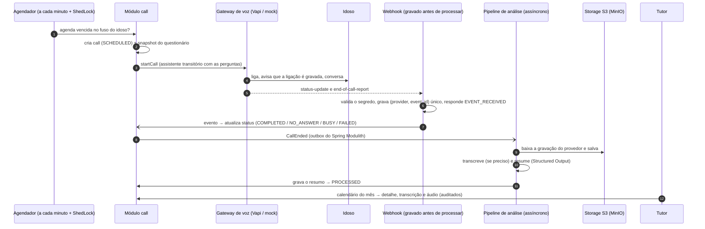
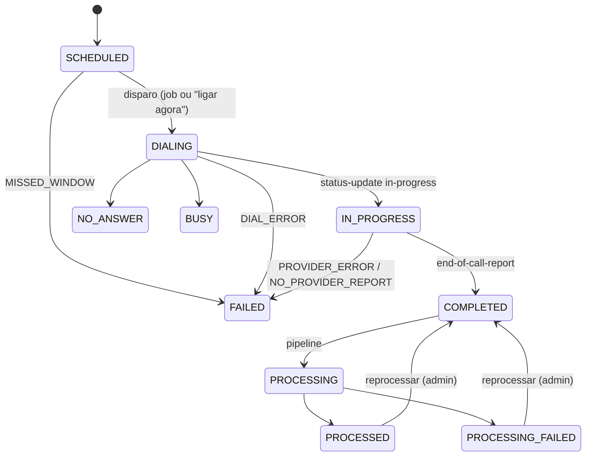
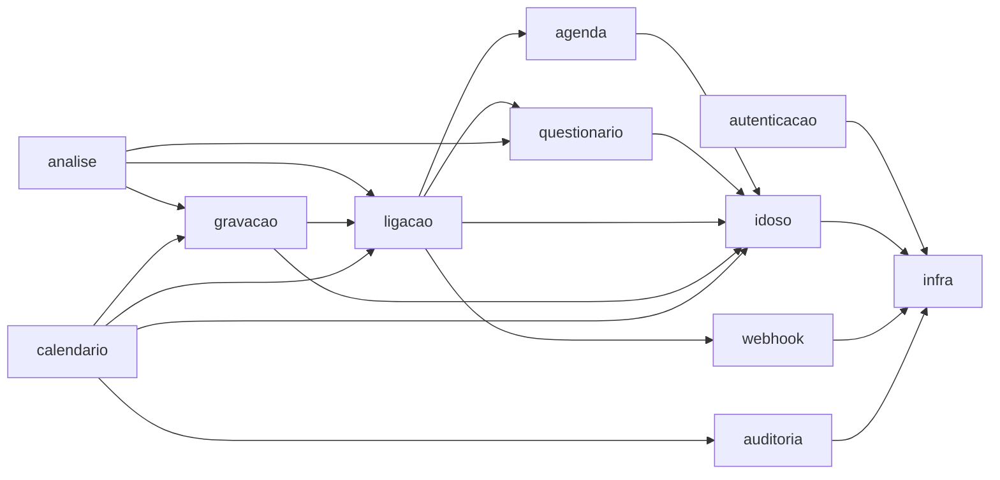

# Cuida — backend

Backend do MVP de **monitoramento conversacional diário de pessoas idosas**. O sistema liga todos
os dias para a pessoa idosa, conversa por voz com IA, grava, transcreve, gera um resumo estruturado
e mostra tudo ao **tutor** (filho, sobrinho, cuidador) em um **calendário**.

> **agenda → liga → conversa → grava → transcreve → salva → resume → exibe no calendário**

Para cada dia, o tutor vê o **resumo** (respostas às perguntas que ele configurou, observações
gerais e nível de alerta), a **transcrição completa** e o **áudio** da ligação.

O projeto roda de ponta a ponta **sem nenhuma chave externa**: no perfil `dev` a ligação, a
transcrição e o resumo são simulados (mocks), e o fluxo do webhook em diante é o mesmo de produção.

| Fase | Conteúdo | Status |
|---|---|---|
| 1 | Fundação: projeto, módulos, Flyway, Testcontainers, CI | ✅ |
| 2 | Segurança (JWT, papéis, ownership), formato de erros, Swagger | ✅ |
| 3 | Cadastros: idosos, agenda, questionário, consentimento | ✅ |
| 4 | Agendamento e telefonia (mock), ShedLock, retentativas, webhook idempotente | ✅ |
| 5 | Pipeline de IA e áudio (S3/MinIO, transcrição, resumo, Resilience4j) | ✅ |
| 6 | Leitura para o tutor: calendário, detalhe, transcrição, áudio, auditoria | ✅ |
| 7 | Adaptador Vapi, retenção/LGPD, documentação, coleção `.http` | ✅ |

---

## Sumário

- [Visão geral das funcionalidades](#visão-geral-das-funcionalidades)
- [Fluxo](#fluxo)
- [Arquitetura](#arquitetura)
- [Padrões da API](#padrões-da-api)
- [Papéis e permissões](#papéis-e-permissões)
- [Endpoints](#endpoints)
- [Modelos e valores](#modelos-e-valores)
- [Regras de negócio](#regras-de-negócio)
- [Armazenamento](#armazenamento)
- [Stack](#stack)
- [Como rodar localmente](#como-rodar-localmente)
- [Configuração (variáveis de ambiente)](#configuração-variáveis-de-ambiente)
- [Testes](#testes)
- [Estrutura de pastas](#estrutura-de-pastas)
- [Decisões técnicas (ADRs)](#decisões-técnicas-adrs)
- [Questões em aberto para discutirmos](#questões-em-aberto-para-discutirmos)

---

## Visão geral das funcionalidades

- **Cadastro do idoso pelo tutor**: nome, apelido usado na conversa, telefone (qualquer formato,
  normalizado para E.164), fuso horário e observações. Ao cadastrar, o idoso já ganha **6 perguntas
  sugeridas** e uma **agenda desligada**.
- **Consentimento de gravação**: sem ele o sistema não liga. O tutor declara, e fica registrado
  quem declarou e quando.
- **Agenda diária no fuso do idoso**: horário, dias da semana, número de tentativas e intervalo
  entre elas.
- **Questionário configurável**: até 12 perguntas (sim/não, escala de 1 a 5 ou resposta livre). Cada
  ligação guarda uma cópia das perguntas da época, então mudar o questionário não altera o
  histórico.
- **Ligação por voz com IA**: um gateway de voz gerenciado (Vapi) liga, conversa e grava. A abertura
  é fixa e sempre avisa que a ligação é gravada.
- **Retentativas automáticas** quando a pessoa não atende, está ocupada ou o provedor falha.
- **"Ligar agora"**: o tutor pode disparar uma ligação fora da agenda.
- **Pipeline pós-ligação assíncrono e durável**: copia o áudio para o nosso armazenamento, transcreve
  (se preciso) e gera o resumo estruturado com IA, com nível de alerta (`NONE`, `ATTENTION`,
  `URGENT`).
- **Calendário do tutor**: um dia por ligação, com resumo, transcrição e áudio. Cada leitura de
  dado sensível é **auditada**.
- **LGPD**: exclusão definitiva do idoso (apaga também os áudios), retenção de 90 dias para os
  áudios e expurgo dos payloads de webhook.

## Fluxo



Estados de uma ligação:



## Arquitetura

O código é organizado **por funcionalidade** (package by feature), com a mesma estrutura e os
mesmos padrões de nome do projeto de referência `exemplos/backend` (Tempo Claro). Cada pasta de
`br.com.cuida` é um **módulo do Spring Modulith** com nome em português e sempre o mesmo formato:

```
idoso/                          ← pasta da funcionalidade
├── IdosoController.java        ← rotas (só delega ao service)
├── IdosoService.java           ← regras do caso de uso
├── AcessoIdosoService.java     ← outro service da funcionalidade (ex.: checagem de acesso)
├── IdosoRepository.java        ← Spring Data
├── (XxxJob, PlanejadorDeXxx…)  ← jobs e classes de lógica com nome descritivo
└── model/
    ├── Idoso.java              ← entidade
    ├── IdosoRequestDTO.java    ← corpo de requisição
    ├── IdosoResponseDTO.java   ← resposta da API
    ├── IdosoDTO.java           ← dados usados por outros módulos
    └── IdosoCadastrado.java    ← eventos e enums
```

Adaptadores de provedores externos ficam em subpastas próprias (`ligacao/vapi`, `ligacao/mock`,
`analise/openai`, `analise/mock`). O que é transversal fica em `infra/`, dividido como no exemplo:
`exception/`, `jwt/`, `security/`, `doc/`, `saude/`, `util/`, além de `persistencia/`,
`agendamento/` e `eventos/`.

Módulos se comunicam apenas pelos **services públicos**, pelos tipos de `model/` (declarado como
interface nomeada do Modulith) ou por **eventos de domínio**. Repositórios e classes de lógica são
internos ao módulo. O build quebra se houver ciclo, acesso a classe interna de outro módulo ou
dependência não declarada (`ModularityTests`).

| Módulo | Responsabilidade | Usado por outros módulos | Pode depender de |
|---|---|---|---|
| `autenticacao` | registro, login, JWT, administrador inicial | — | `infra` |
| `idoso` | cadastro do idoso, consentimento, exclusão LGPD | `AcessoIdosoService`, `model` (`IdosoDTO`, eventos `IdosoCadastrado` / `IdosoExcluido`) | `infra` |
| `agenda` | agenda de ligações | `AgendaService`, `model` (`AgendaDTO`) | `infra`, `idoso` |
| `questionario` | perguntas e snapshot | `QuestionarioService`, `model` (`QuestionarioSnapshot`, `TipoResposta`) | `infra`, `idoso` |
| `ligacao` | ciclo de vida da ligação, agendador, retentativas, disparo, porta `GatewayDeVoz` (+ `vapi/`, `mock/`) | `ConsultaLigacaoService`, `ProcessamentoLigacaoService`, `model` (`LigacaoDTO`, `LigacaoResponseDTO`, evento `LigacaoEncerrada`) | `infra`, `idoso`, `agenda`, `questionario`, `webhook` |
| `webhook` | recepção idempotente e reprocessamento | `RecebimentoWebhookService`, `EventoWebhookService`, `model` (evento `WebhookRecebido`) | `infra` |
| `analise` | pipeline pós-ligação, transcrição e resumo com IA (portas `Transcritor`/`Resumidor` + `openai/`, `mock/`) | — | `infra`, `ligacao`, `gravacao`, `questionario` |
| `gravacao` | armazenamento de áudio (porta `ArmazenamentoDeAudio`: S3 ou disco), cópia da gravação, retenção | `GravacaoService`, `model` (`ConteudoAudio`) | `infra`, `ligacao`, `idoso` |
| `calendario` | leitura do tutor: calendário, detalhe, transcrição, áudio, log de acessos | — | `infra`, `ligacao`, `idoso`, `gravacao`, `auditoria` |
| `auditoria` | log de acesso a dados sensíveis | `AuditoriaService`, `model` | `infra` |
| `infra` | segurança, JWT, exceções, OpenAPI, jobs, persistência, utilitários | tudo (módulo aberto) | nenhum |



Rotas, JSON e colunas do banco continuam em inglês: são o contrato da API e do esquema (veja
[Padrões da API](#padrões-da-api)). A tradução vale para pastas, arquivos e classes.

Os diagramas gerados pelo Modulith (PlantUML/AsciiDoc) ficam em [`docs/modules/`](docs/modules)
e são regenerados a cada `./mvnw verify`.

**Portas e adaptadores.** Tudo que é externo fica atrás de uma interface, e o adaptador é escolhido
por propriedade:

| Porta | Adaptadores | Propriedade | Padrão |
|---|---|---|---|
| `GatewayDeVoz` (ligar) | `GatewayDeVozSimulado`, `GatewayDeVozVapi` | `app.voice.provider` = `mock` \| `vapi` | `mock` |
| `ArmazenamentoDeAudio` (guardar áudio) | `ArmazenamentoS3` (MinIO/AWS), `ArmazenamentoEmDisco` | `app.storage.provider` = `s3` \| `filesystem` | `s3` |
| `Transcritor` / `Resumidor` (IA) | `TranscritorSimulado`/`ResumidorSimulado`, `TranscritorOpenAi`/`ResumidorOpenAi` | `app.ai.provider` = `mock` \| `openai` | `mock` |

A conversa em tempo real **não** passa pelo servidor Java: ela é delegada ao gateway de voz. O
mock não liga para ninguém; ele entrega ao `RecebimentoWebhookService` os mesmos eventos que o Vapi mandaria,
no mesmo formato, então o caminho do webhook em diante é idêntico ao de produção.

**Processamento assíncrono durável.** Os eventos entre módulos (`WebhookRecebido`, `LigacaoEncerrada`,
`IdosoExcluido`) são gravados na tabela `event_publication` na mesma transação da mudança de
estado (outbox do Spring Modulith). Se a aplicação cair, as publicações pendentes são reenviadas na
inicialização e por um job a cada 5 minutos. Os eventos carregam **só ids**, nunca transcrição ou
telefone.

## Padrões da API

O contrato HTTP e a forma de armazenar seguem os padrões da outra API da equipe
([ADR 0007](docs/adr/0007-contrato-da-api-no-padrao-do-whats-api.md)), para que os frontends
reaproveitem o mesmo tratamento.

| Aspecto | Padrão |
|---|---|
| Base | tudo sob `/api`; webhooks fora (`/webhook/vapi`) |
| Autenticação | `Authorization: Bearer <token>` (JWT de `POST /api/login` ou `/api/register`) |
| Formato | JSON camelCase; enums como texto em maiúsculas; ids UUID |
| Listas | array puro, sem envelope de paginação |
| Datas | `LocalDateTime` sem offset (`"2026-10-17T09:30:00"`), **no fuso do idoso** (campo `timezone` do cadastro); datas puras como `"2026-10-17"`; horários como `"09:30"` |
| Criação | `200` com o recurso criado |
| Atualização (`PUT`) | `200` com o recurso atualizado (substitui o recurso inteiro) |
| Exclusão | `200` sem corpo |
| Recurso de outro tutor | `404` (nunca `403`: não revela que existe) |
| Erro | `{"status": 404, "message": "Idoso não encontrado: 3f2c…"}` |
| Erro de validação | `{"status": 400, "message": "Dados inválidos", "errors": [{"field": "name", "message": "…"}]}` |

Códigos usados:

| Código | Quando |
|---|---|
| `200` | sucesso (inclusive criação e exclusão) |
| `400` | JSON mal formado, parâmetro inválido, validação (com `errors`) |
| `401` | sem token, token inválido/expirado, login errado; webhook com segredo errado (sem corpo) |
| `403` | papel insuficiente (rota só de administrador) |
| `404` | não existe ou não é seu |
| `409` | conflito: e-mail já cadastrado, ligação em andamento, alteração concorrente |
| `410` | áudio já apagado pela retenção |
| `422` | regra de negócio: "ligar agora" sem consentimento de gravação |
| `500` | erro interno (a mensagem nunca expõe detalhes da exceção) |

Exemplo de erro de validação real (lista no corpo, `PUT /questionnaire`):

```json
{
  "status": 400,
  "message": "Dados inválidos",
  "errors": [
    { "field": "[0].attributeKey", "message": "use de 2 a 40 letras minúsculas, números ou _, começando por letra" },
    { "field": "[0].questionText", "message": "não deve estar em branco" }
  ]
}
```

**Swagger UI:** `http://localhost:8080/swagger-ui.html`, ligado só no perfil `dev`
(`SWAGGER_ENABLED`). Use o botão *Authorize* com o token do login.

## Papéis e permissões

Dois papéis, gravados em `users.role`: **`TUTOR`** (todo registro público) e **`ADMIN`** (criado
na inicialização a partir de `APP_BOOTSTRAP_ADMIN_EMAIL`/`_PASSWORD`; no `dev` já existe
`admin@cuida.local` / `admin12345`). Não há endpoint para virar administrador.

| Ação | Admin | Tutor |
|---|---|---|
| Cadastrar idoso | Sim (vira tutor dele) | Sim (vira tutor dele) |
| Ver/editar/excluir idoso, agenda, questionário, consentimento | Qualquer idoso | Só os seus (404 nos outros) |
| "Ligar agora" | Qualquer idoso | Só os seus |
| Calendário, detalhe, transcrição, áudio | Qualquer idoso | Só os seus |
| Reprocessar uma ligação (`POST /api/calls/{id}/reprocess`) | Sim | Não (403) |
| Log de acessos (`GET /api/elderly/{id}/access-log`) | Sim | Não (403) |
| `/actuator/**` (exceto health/info) | Sim | Não (403) |

## Endpoints

Coleção pronta para o HTTP Client do IntelliJ em [`http/`](http) (`01-auth` → `04-leitura-tutor`,
na ordem). Os exemplos abaixo são respostas reais do perfil `dev`.

### Públicos

| Método e rota | Descrição |
|---|---|
| `POST /api/register` | cria um tutor e já devolve o token |
| `POST /api/login` | autentica |
| `GET /api/ping` | `{"status": "ok"}` para monitoramento externo |
| `GET /actuator/health` (`/liveness`, `/readiness`) | saúde da aplicação |
| `POST /webhook/vapi` | eventos do Vapi (protegido por segredo no header) |

`POST /api/register` — corpo `{name, email, password}` (senha de 8 a 72 bytes). `POST /api/login`
— corpo `{email, password}`. Os dois devolvem:

```json
{
  "token": "eyJraWQiOi...",
  "expiresIn": 3600,
  "userId": "7ac78996-86e2-49c3-8ea2-2e517f4c7cd0",
  "name": "Ana Souza",
  "email": "ana@exemplo.com",
  "role": "TUTOR"
}
```

Login errado: `401 {"status": 401, "message": "E-mail ou senha inválidos"}` (mesma resposta para
e-mail inexistente). E-mail repetido no registro: `409`.

### Idosos — `/api/elderly`

| Método e rota | Corpo | Resposta |
|---|---|---|
| `POST /api/elderly` | `IdosoRequestDTO` | `IdosoResponseDTO` |
| `GET /api/elderly` | — | `[IdosoResponseDTO]` (admin: todos; tutor: os seus), por nome |
| `GET /api/elderly/{elderlyId}` | — | `IdosoResponseDTO` |
| `PUT /api/elderly/{elderlyId}` | `IdosoRequestDTO` (substitui tudo) | `IdosoResponseDTO` |
| `PUT /api/elderly/{elderlyId}/consent` | `{"recordingConsent": true}` | `IdosoResponseDTO` |
| `DELETE /api/elderly/{elderlyId}` | — | `200` vazio. Exclusão definitiva (LGPD) |

`IdosoRequestDTO`:

```json
{
  "name": "Maria da Silva",
  "preferredName": "Dona Maria",
  "phoneNumber": "(11) 98765-4321",
  "timezone": "America/Sao_Paulo",
  "notes": "Usa aparelho auditivo",
  "active": true
}
```

`name` (até 120) e `phoneNumber` são obrigatórios. `preferredName` (até 60) é como a assistente
chama a pessoa. `timezone` é um fuso IANA (padrão `America/Sao_Paulo`). `active: false` faz o
agendador parar de ligar (padrão `true`). O telefone aceita qualquer formatação; DDD + número
ganha o DDI 55.

`IdosoResponseDTO`:

```json
{
  "id": "7f257020-f54e-43ad-9f16-fdc26ecf0bcf",
  "tutorId": "7ac78996-86e2-49c3-8ea2-2e517f4c7cd0",
  "name": "Maria da Silva",
  "preferredName": "Dona Maria",
  "phoneNumber": "+5511987654321",
  "timezone": "America/Sao_Paulo",
  "notes": "Usa aparelho auditivo",
  "active": true,
  "recordingConsent": false,
  "consentRecordedAt": null,
  "createdAt": "2026-10-17T13:11:03",
  "updatedAt": "2026-10-17T13:11:03"
}
```

### Agenda — `/api/elderly/{elderlyId}/schedule`

| Método | Corpo | Resposta |
|---|---|---|
| `GET` | — | `AgendaResponseDTO` |
| `PUT` | `AgendaRequestDTO` | `AgendaResponseDTO` |

```json
{
  "localTime": "09:30",
  "daysOfWeek": ["MONDAY", "WEDNESDAY", "FRIDAY"],
  "active": true,
  "maxAttempts": 3,
  "retryIntervalMinutes": 20
}
```

`localTime` (`"HH:mm"`, no fuso do idoso), `daysOfWeek` e `active` são obrigatórios; agenda ativa
precisa de ao menos um dia. `maxAttempts` vai de 1 a 5 (padrão 3) e `retryIntervalMinutes` de 5 a
240 (padrão 20). A resposta repete os campos e acrescenta `elderlyId` e `nextCallAt` (próxima
ligação no fuso do idoso, `null` se inativa):

```json
{
  "elderlyId": "7f257020-f54e-43ad-9f16-fdc26ecf0bcf",
  "localTime": "09:30",
  "daysOfWeek": ["MONDAY", "WEDNESDAY", "FRIDAY"],
  "active": true,
  "maxAttempts": 3,
  "retryIntervalMinutes": 20,
  "nextCallAt": "2026-10-19T09:30:00"
}
```

### Questionário — `/api/elderly/{elderlyId}/questionnaire`

| Método | Corpo | Resposta |
|---|---|---|
| `GET` | — | `[ItemQuestionarioResponseDTO]` na ordem |
| `PUT` | `[ItemQuestionarioRequestDTO]` (substitui a lista inteira) | `[ItemQuestionarioResponseDTO]` |

```json
[
  { "attributeKey": "sleep", "questionText": "Como dormiu esta noite?", "answerType": "FREE_TEXT" },
  { "attributeKey": "medication", "questionText": "Tomou os remédios de hoje?", "answerType": "YES_NO" },
  { "attributeKey": "water", "questionText": "Bebeu água hoje?", "answerType": "YES_NO", "active": false }
]
```

No máximo 12 itens; `attributeKey` é única, minúscula (`^[a-z][a-z0-9_]{1,39}$`) e estável; a
ordem da lista vira a ordem das perguntas (`position`). Item com a mesma chave é atualizado (mantém
o `id`), item novo é criado e o que saiu da lista é apagado. `active: false` guarda sem perguntar.
Resposta:

```json
[
  {
    "id": "457dddc9-5480-4dc5-941d-b932161823b7",
    "attributeKey": "sleep",
    "questionText": "Como dormiu esta noite?",
    "answerType": "FREE_TEXT",
    "position": 0,
    "active": true
  }
]
```

### Ligações

| Método e rota | Resposta | Observação |
|---|---|---|
| `POST /api/elderly/{elderlyId}/calls` | `LigacaoResponseDTO` | "ligar agora"; `422` sem consentimento, `409` com ligação em andamento |
| `GET /api/elderly/{elderlyId}/calls?date=2026-10-17` | `[LigacaoResponseDTO]` | todas as tentativas do dia (padrão: hoje no fuso do idoso) |
| `POST /api/calls/{callId}/reprocess` | `LigacaoResponseDTO` | só admin; roda o pipeline de novo (`409` se não estiver `PROCESSED`/`PROCESSING_FAILED`) |

`LigacaoResponseDTO` (ligação manual já processada):

```json
{
  "id": "08dd9c2a-dade-473b-ac2a-16fb0034e9d1",
  "elderlyId": "7f257020-f54e-43ad-9f16-fdc26ecf0bcf",
  "trigger": "MANUAL",
  "status": "PROCESSED",
  "localDate": "2026-10-17",
  "attempt": 1,
  "scheduledFor": "2026-10-17T13:11:04",
  "startedAt": "2026-10-17T13:11:04",
  "endedAt": "2026-10-17T13:12:39",
  "durationSeconds": 95,
  "endReason": "assistant-ended-call",
  "failureReason": null,
  "alertLevel": "URGENT",
  "mood": "GOOD",
  "summaryText": "Resumo simulado: ligação concluída, 6 de 6 perguntas respondidas. A pessoa relatou algo que exige atenção imediata.",
  "hasTranscript": true,
  "hasAudio": true
}
```

Logo após o `POST`, a resposta vem com `status: "DIALING"`; o restante é preenchido quando o
webhook chega e o pipeline termina.

### Calendário e leitura do tutor

| Método e rota | Resposta | Auditoria |
|---|---|---|
| `GET /api/elderly/{elderlyId}/calendar?month=2026-10` | `[DiaCalendarioResponseDTO]` (padrão: mês atual) | — |
| `GET /api/calls/{callId}` | `DetalheLigacaoResponseDTO` | `VIEW_SUMMARY` (se houver resumo) |
| `GET /api/calls/{callId}/transcript` | `TranscricaoResponseDTO` (`404` se não houver) | `VIEW_TRANSCRIPT` |
| `GET /api/calls/{callId}/audio` | bytes do áudio (`410` se expurgado) | `PLAY_AUDIO` |
| `GET /api/elderly/{elderlyId}/access-log` | `[RegistroAcessoResponseDTO]` (só admin, 500 mais recentes) | — |

`DiaCalendarioResponseDTO` — só dias com ligação, em ordem. Mostra a ligação mais relevante do dia (a
última processada; senão, a última tentativa); `attempts` conta todas:

```json
[
  {
    "date": "2026-10-17",
    "callId": "08dd9c2a-dade-473b-ac2a-16fb0034e9d1",
    "status": "PROCESSED",
    "alertLevel": "URGENT",
    "mood": "GOOD",
    "summaryText": "Resumo simulado: ligação concluída, 6 de 6 perguntas respondidas. A pessoa relatou algo que exige atenção imediata.",
    "attempts": 1,
    "hasTranscript": true,
    "hasAudio": true
  }
]
```

`DetalheLigacaoResponseDTO` — os campos de `LigacaoResponseDTO` (sem `mood`/`hasAudio`) mais o resumo completo
e o caminho do áudio:

```json
{
  "id": "08dd9c2a-dade-473b-ac2a-16fb0034e9d1",
  "status": "PROCESSED",
  "localDate": "2026-10-17",
  "alertLevel": "URGENT",
  "summaryText": "Resumo simulado: …",
  "summary": {
    "overview": "Resumo simulado: …",
    "mood": "GOOD",
    "answers": [
      {
        "attributeKey": "pain",
        "question": "Está sentindo alguma dor? De 1 a 5, quanto?",
        "answer": "Ai, ontem à noite eu caí no banheiro e estou com uma dor forte no quadril, uns 5.",
        "clarity": "CLEAR"
      }
    ],
    "notableMentions": ["Minha neta vem me visitar à tarde."],
    "alertLevel": "URGENT",
    "alertReasons": ["Ai, ontem à noite eu caí no banheiro e estou com uma dor forte no quadril, uns 5."],
    "followUpSuggested": true
  },
  "hasTranscript": true,
  "audioUrl": "/api/calls/08dd9c2a-dade-473b-ac2a-16fb0034e9d1/audio",
  "audioPurged": false
}
```

`TranscricaoResponseDTO` — `source` é `PROVIDER` (veio do gateway de voz) ou `WHISPER` (nossa
transcrição). As falas vêm rotuladas `Assistente:` e `Idoso(a):`, uma por linha:

```json
{
  "callId": "08dd9c2a-dade-473b-ac2a-16fb0034e9d1",
  "source": "PROVIDER",
  "transcript": "Assistente: Olá, Dona Maria! Aqui é a Cuida, … Esta ligação é gravada …\nIdoso(a): Oi, pode falar sim, minha filha.\nAssistente: Como dormiu esta noite?\nIdoso(a): Dormi bem, acordei só uma vez para ir ao banheiro.\n…"
}
```

Áudio — o arquivo é servido pela própria API, com o token (nunca por link público):

```
HTTP/1.1 200
Content-Type: audio/mpeg
Content-Length: 23840
Content-Disposition: inline; filename="ligacao-2026-10-17-1.mp3"
Accept-Ranges: bytes
Cache-Control: private, no-store
```

Aceita `Range: bytes=…` de uma faixa (responde `206`), para o player poder avançar o áudio.

`RegistroAcessoResponseDTO` (horário no fuso do idoso):

```json
[
  {
    "id": "eeb84252-1bd0-44c7-b6fb-dfa79757e0d4",
    "userId": "7ac78996-86e2-49c3-8ea2-2e517f4c7cd0",
    "callId": "08dd9c2a-dade-473b-ac2a-16fb0034e9d1",
    "action": "PLAY_AUDIO",
    "ip": "203.0.113.10",
    "occurredAt": "2026-10-17T13:11:06"
  }
]
```

### Webhook do Vapi — `POST /webhook/vapi` (⚠️ fora de `/api`)

Sem JWT. Exige o header `X-Webhook-Secret` igual a `VAPI_WEBHOOK_SECRET` (comparação em tempo
constante); o próprio backend envia esse header ao Vapi dentro do assistente. Respostas: `200`
com o texto `EVENT_RECEIVED` (inclusive para eventos repetidos ou de tipos que não usamos), `401`
sem corpo com segredo ausente/errado, `400` com JSON inválido. Só `status-update` e
`end-of-call-report` são gravados e processados:

```json
{
  "message": {
    "type": "end-of-call-report",
    "endedReason": "customer-ended-call",
    "startedAt": "2026-10-17T12:00:00.000Z",
    "endedAt": "2026-10-17T12:03:10.000Z",
    "durationSeconds": 190,
    "call": { "id": "id-no-vapi", "metadata": { "callId": "08dd9c2a-…" } },
    "artifact": {
      "transcript": "AI: Olá, Dona Maria!\nUser: Oi, tudo bem?",
      "recordingUrl": "https://storage.vapi.ai/….mp3"
    }
  }
}
```

## Modelos e valores

| Campo | Valores |
|---|---|
| `role` | `TUTOR`, `ADMIN` |
| `answerType` | `YES_NO`, `SCALE_1_5`, `FREE_TEXT` |
| `daysOfWeek` | `MONDAY` … `SUNDAY` |
| `trigger` | `SCHEDULED` (agenda), `RETRY` (retentativa), `MANUAL` ("ligar agora") |
| `status` | `SCHEDULED`, `DIALING`, `IN_PROGRESS`, `COMPLETED`, `NO_ANSWER`, `BUSY`, `FAILED`, `PROCESSING`, `PROCESSED`, `PROCESSING_FAILED` |
| `alertLevel` | `NONE`, `ATTENTION`, `URGENT` (queda, dor forte, falta de ar, confusão, pedido de ajuda) |
| `mood` | `GOOD`, `NEUTRAL`, `LOW`, `UNCLEAR` |
| `clarity` (resposta) | `CLEAR`, `PARTIAL`, `NOT_ASKED`, `NOT_ANSWERED` |
| `source` (transcrição) | `PROVIDER`, `WHISPER` |
| `action` (auditoria) | `VIEW_SUMMARY`, `VIEW_TRANSCRIPT`, `PLAY_AUDIO` |

`failureReason` (código, às vezes seguido de `": detalhe"`):

| Código | Significado | Gera retentativa? |
|---|---|---|
| `RECORDING_CONSENT_MISSING` | sem consentimento: o agendador não ligou | Não |
| `ELDERLY_INACTIVE` | idoso desativado entre o agendamento e o disparo | Não |
| `DIAL_ERROR` | o gateway recusou ou não respondeu | Sim |
| `PROVIDER_ERROR` | o provedor encerrou com erro (telefonia, pipeline) | Sim |
| `CANCELED` | cancelada manualmente no provedor | Não |
| `MISSED_WINDOW` | passou da janela de recuperação (app fora do ar) | Não |
| `NO_PROVIDER_REPORT` | o relatório final não chegou em 30 min | Não |
| `EMPTY_TRANSCRIPT` / `PIPELINE_ERROR` | falha no pipeline (status `PROCESSING_FAILED`) | reprocesso manual |

## Regras de negócio

**Agendador** (job a cada minuto, uma instância por vez via ShedLock):

- Para cada agenda ativa de idoso ativo, calcula o horário do dia **no fuso do idoso** (em um
  "buraco" de horário de verão, a hora é empurrada para frente). Olha também o dia anterior, para
  uma agenda das 23h30 ainda ser recuperada logo depois da meia-noite.
- Cria a 1ª tentativa se já passou do horário e ainda está dentro da **janela de recuperação de
  2h** (`APP_CALLS_RECOVERY_WINDOW`). Depois disso, o dia é pulado.
- **Sem consentimento**, não liga: registra o dia como `FAILED / RECORDING_CONSENT_MISSING`.
- Um índice único `(elderly_id, local_date, attempt)` (só para ligações não manuais) impede
  duplicatas mesmo com duas instâncias.

**Disparo**: a ligação vencida é "reservada" (`SCHEDULED → DIALING` com update condicional) antes
de chamar o gateway, então o job e o "ligar agora" nunca ligam duas vezes. O pedido ao provedor
**não é repetido** em caso de erro (um POST que estourou o tempo pode já ter criado a ligação).

**Retentativas**: `NO_ANSWER`, `BUSY`, `DIAL_ERROR` e `PROVIDER_ERROR` geram uma nova linha
(`trigger = RETRY`, `attempt + 1`) para `fim da anterior + retry_interval_minutes`, até
`max_attempts`. O questionário é lido de novo na retentativa.

**Ligar agora**: sempre permitido, exceto sem consentimento (`422`) ou com ligação `DIALING` /
`IN_PROGRESS` para o mesmo idoso (`409`). Não conta para o limite diário nem cancela a agendada.

**Ligações travadas**: em `DIALING`/`IN_PROGRESS` sem relatório há mais de 30 min viram
`FAILED / NO_PROVIDER_REPORT` (sem retentativa: a pessoa pode ter atendido). Um relatório que
chegue depois ainda recupera o dia.

**Webhook**: o evento é **gravado antes de ser processado**, com id derivado
`{callId}:{tipo}[:{status}]` (o Vapi não manda id de evento) e `(provider, event_id)` único:
entregas repetidas são reconhecidas e descartadas. O processamento é assíncrono; eventos da mesma
ligação processados em paralelo são reaplicados em caso de conflito de versão. Falhas ficam
`FAILED` e são reenviadas a cada minuto, até 5 tentativas. O payload é apagado assim que o evento
termina.

**Pipeline pós-ligação** (só para `COMPLETED`):

1. `COMPLETED → PROCESSING`.
2. Copia a gravação do provedor para o storage. Só baixa **HTTPS de hosts permitidos**
   (`storage.vapi.ai`, `*.vapi.ai`), até 50 MB, com 3 tentativas em erro de rede/5xx. Se a cópia
   falhar mas houver transcrição, o resumo sai mesmo assim (sem áudio).
3. Transcreve com a OpenAI se `APP_TRANSCRIPTION_MODE=WHISPER` ou se o provedor não mandou
   transcrição.
4. Resume com **Structured Output** (JSON Schema de `ResumoLigacao` no `response_format`). O nome da
   pessoa não vai para a IA, e a transcrição é tratada como dado, entre delimitadores.
5. Normaliza: exatamente uma resposta por pergunta do snapshot (as que faltarem viram `NOT_ASKED`,
   chaves inventadas são descartadas), `alertReasons` vazio quando `NONE`. **Rede de segurança:**
   se a fala da pessoa menciona queda, dor no peito, falta de ar ou pedido de ajuda e o modelo
   disse `NONE`, o alerta sobe para `ATTENTION` pedindo confirmação.
6. Valida (Jakarta Validation) e grava → `PROCESSED`. Qualquer falha → `PROCESSING_FAILED` com o
   motivo; o administrador pode reprocessar.

Chamadas de IA: 3 tentativas com espera exponencial (2 s, 4 s) para rede, 5xx e resumo inválido;
**nenhum 4xx é repetido** (nem 429); circuit breaker abre com 50% de falhas. Os retries internos do
SDK ficam desligados.

**Conversa**: a abertura é fixa e sempre avisa que a ligação é gravada ("Olá, Dona Maria! Aqui é a
Cuida, … Esta ligação é gravada para que eles possam acompanhar como você está…"). As instruções
pedem frases curtas, uma pergunta por vez, nada de conselho médico, orientação a ligar 192 em
emergência, respeito a quem não quiser conversar e nunca pedir dados pessoais ou dinheiro.

**LGPD**:

- `DELETE /api/elderly/{id}` apaga o idoso e, em cascata, agenda, perguntas e ligações; depois
  apaga todos os áudios dele no storage. Os logs de auditoria ficam, com `elderly_id`/`call_id`
  nulos.
- Áudios com mais de 90 dias (`APP_RETENTION_AUDIO_DAYS`) são apagados todo dia às 3h15; a ligação
  fica com `audio_purged_at` e o áudio responde `410`. Transcrição e resumo continuam.
- Payloads de webhook que nunca terminaram são apagados depois de 7 dias.
- Publicações de eventos concluídas são apagadas depois de 7 dias.

**Gateway mock (dev/testes)**: não liga para ninguém; depois de `APP_VOICE_MOCK_DELAY` (3 s)
entrega os webhooks simulados. O cenário vem dos **4 últimos dígitos do telefone**:

| Final | Cenário |
|---|---|
| `0000` | não atende (`NO_ANSWER`) |
| `1111` | ocupado (`BUSY`) |
| `2222` | erro ao discar (`FAILED / DIAL_ERROR`, na hora) |
| `9999` | conversa com relato de queda (`URGENT`) |
| outro | conversa normal |

O resumo mock é feito por regras simples (a resposta de cada pergunta é a fala seguinte) e
começa com "Resumo simulado".

## Armazenamento

PostgreSQL 16, esquema versionado pelo Flyway (`ddl-auto=validate`). Convenções: ids **UUID
gerados pela aplicação**, colunas `snake_case`, enums como `varchar` + `CHECK`, datas em
`timestamptz` (UTC), estruturas em `jsonb`.

| Tabela | Conteúdo |
|---|---|
| `users` | `name`, `email` (único, sempre minúsculo), `password_hash` (BCrypt), `role` (`TUTOR`/`ADMIN`) |
| `elderly` | `tutor_id`, `name`, `preferred_name`, `phone_number` (E.164, `CHECK`), `timezone` (IANA), `notes`, `active`, `recording_consent`, `consent_recorded_at`, `consent_recorded_by` |
| `call_schedules` | uma por idoso: `local_time`, `days_of_week` (`jsonb`), `active`, `max_attempts` (1–5), `retry_interval_minutes` (5–240) |
| `questionnaire_items` | `attribute_key` (única por idoso), `question_text`, `answer_type`, `position`, `active` |
| `calls` | uma linha por tentativa: `trigger_type`, `scheduled_for`, `local_date` (no fuso do idoso), `attempt`, `status`, `provider`, `provider_call_id` (único), `started_at`, `ended_at`, `duration_seconds`, `end_reason`, `failure_reason`, `transcript`, `transcript_source`, `questionnaire_snapshot` (`jsonb`), `structured_summary` (`jsonb`), `summary_text` e `alert_level` (desnormalizados), `audio_object_key`, `audio_mime_type`, `audio_size_bytes`, `audio_purged_at`, `version` (lock otimista) |
| `webhook_events` | `provider`, `event_id` (único por provedor), `event_type`, `payload` (`jsonb`, apagado ao terminar), `status` (`PENDING`/`PROCESSED`/`FAILED`/`IGNORED`), `attempts`, `received_at`, `processed_at`, `error` |
| `access_audit_logs` | `user_id`, `elderly_id`, `call_id`, `action`, `ip`, `occurred_at` |
| `shedlock` | locks dos jobs (colunas `timestamp` em UTC) |
| `event_publication` | outbox do Spring Modulith |

Exemplos do que fica em `jsonb`:

```jsonc
// call_schedules.days_of_week
["MONDAY", "WEDNESDAY", "FRIDAY"]

// calls.questionnaire_snapshot — cópia das perguntas no momento da ligação
{"items": [{"attributeKey": "sleep", "questionText": "Como dormiu esta noite?", "answerType": "FREE_TEXT", "position": 0}]}

// calls.structured_summary — o mesmo objeto "summary" devolvido em GET /api/calls/{id}
{"overview": "…", "mood": "GOOD", "answers": [{"attributeKey": "sleep", "question": "…", "answer": "…", "clarity": "CLEAR"}],
 "notableMentions": [], "alertLevel": "NONE", "alertReasons": [], "followUpSuggested": false}
```

Índices principais: calendário `(elderly_id, local_date)`, despacho `(status, scheduled_for)`,
ligações em andamento `(elderly_id, status)`, GIN em `structured_summary`, retenção de áudio
`(ended_at) where audio_object_key is not null`, webhooks pendentes/com falha `(status,
received_at)`.

**Áudio**: no bucket `S3_BUCKET` (MinIO no dev) ou numa pasta local, com a chave
`elderly/{elderlyId}/calls/{callId}.{mp3|wav|ogg|m4a|…}`. O tipo MIME e o tamanho ficam na própria
ligação (`audio_mime_type`, `audio_size_bytes`). A URL de gravação do provedor é descartada depois
da cópia.

| Migration | Conteúdo |
|---|---|
| `V1__baseline.sql` | esquema inicial completo |
| `V2__user_role_column.sql` | papel em coluna única `users.role` (substitui `user_roles`) |
| `V3__webhook_status_and_call_indexes.sql` | `status`/`attempts` do webhook, índices do agendador |
| `V4__shedlock_utc_timestamps.sql` | colunas do ShedLock em `timestamp` UTC |
| `V5__call_audio_metadata.sql` | tipo, tamanho e expurgo do áudio na ligação |

## Stack

| Item | Versão |
|---|---|
| Java | 21 (LTS) |
| Spring Boot | 4.1.1 (Spring Framework 7.0, Spring Security 7.1, Hibernate 7.4, Jackson 3.1) |
| Spring AI | 2.0.1 (OpenAI: transcrição + Structured Output), montado sem autoconfiguração |
| Spring Modulith | 2.1.1 (módulos verificados + outbox de eventos em JDBC) |
| Banco | PostgreSQL 16 + Flyway 12 |
| Armazenamento | S3 compatível: MinIO (imagem Chainguard) + AWS SDK v2; ou disco local |
| Resiliência / jobs | Resilience4j 2.4 (programático), ShedLock 7.10 |
| Documentação da API | springdoc-openapi 3.1 (Swagger UI com Bearer, só no dev) |
| Testes | JUnit 6, Spring Boot Test, Testcontainers 2.0 (Postgres e MinIO reais), MockMvc, Awaitility |
| Build | Maven Wrapper 3.9.16, Spotless (google-java-format), GitHub Actions |

## Como rodar localmente

**Pré-requisitos:** JDK 21 e Docker (com Compose v2).

> Nesta máquina de desenvolvimento, o `java` padrão é o 17 e `/usr/lib/jvm/java-21-openjdk` é
> só JRE. Use o Temurin 21 do SDKMAN (`sdk env` lê o `.sdkmanrc`) ou exporte
> `JAVA_HOME=$HOME/.sdkman/candidates/java/21.0.12+1.1-tem`. O build falha cedo (enforcer) com
> JDK < 21.

```bash
cp .env.example .env              # opcional: os defaults do perfil dev já funcionam
docker compose up -d              # Postgres 16 + MinIO + criação do bucket
./mvnw spring-boot:run            # perfil dev (mocks, sem chaves)
curl localhost:8080/api/ping      # {"status":"ok"}
```

- Swagger UI: <http://localhost:8080/swagger-ui.html>.
- Console do MinIO: <http://localhost:9001> (`MINIO_ROOT_USER` / `MINIO_ROOT_PASSWORD`).
- Sem MinIO: `APP_STORAGE_PROVIDER=filesystem` grava os áudios em `./data/recordings`.
- Aplicação em container: `docker compose --profile app up -d --build`.

### Testar uma ligação simulada (mock)

Com a coleção [`http/`](http) (rode na ordem) ou com `curl`:

```bash
B=http://localhost:8080
TOKEN=$(curl -s -XPOST $B/api/register -H 'Content-Type: application/json' \
  -d '{"name":"Ana","email":"ana@exemplo.com","password":"senha-segura-123"}' | jq -r .token)

ID=$(curl -s -XPOST $B/api/elderly -H "Authorization: Bearer $TOKEN" -H 'Content-Type: application/json' \
  -d '{"name":"Maria da Silva","preferredName":"Dona Maria","phoneNumber":"11987659999"}' | jq -r .id)

curl -s -XPUT $B/api/elderly/$ID/consent -H "Authorization: Bearer $TOKEN" \
  -H 'Content-Type: application/json' -d '{"recordingConsent":true}'

CALL=$(curl -s -XPOST $B/api/elderly/$ID/calls -H "Authorization: Bearer $TOKEN" | jq -r .id)
sleep 6
curl -s $B/api/elderly/$ID/calendar -H "Authorization: Bearer $TOKEN" | jq
curl -s $B/api/calls/$CALL -H "Authorization: Bearer $TOKEN" | jq .summary
curl -s $B/api/calls/$CALL/audio -H "Authorization: Bearer $TOKEN" -o ligacao.mp3
```

O telefone terminado em `9999` gera o cenário de queda (`URGENT`); veja os outros finais em
[Regras de negócio](#regras-de-negócio). Para testar o **agendador**, ative a agenda com um horário
1 ou 2 minutos à frente (no fuso do idoso).

### Ligação real (Vapi)

1. No [Vapi](https://vapi.ai), crie a chave privada da API e importe/compre um número de saída
   (para o Brasil, um número +55 via Twilio/Telnyx). Anote o `phoneNumberId`.
2. Exponha o backend com HTTPS (em dev, um túnel: `cloudflared tunnel --url
   http://localhost:8080` ou `ngrok http 8080`).
3. No `.env`:

   ```bash
   APP_VOICE_PROVIDER=vapi
   VAPI_API_KEY=...
   VAPI_PHONE_NUMBER_ID=...
   VAPI_WEBHOOK_BASE_URL=https://seu-tunel.trycloudflare.com
   VAPI_WEBHOOK_SECRET=$(openssl rand -hex 32)
   # Opcional: resumo/transcrição reais
   APP_AI_PROVIDER=openai
   OPENAI_API_KEY=...
   ```

4. Reinicie, cadastre um idoso com **o seu** telefone, registre o consentimento e use "ligar
   agora". O assistente é montado a cada ligação (não precisa criar nada no painel do Vapi); o
   webhook chega em `/webhook/vapi` com o segredo no header `X-Webhook-Secret`.

A aplicação recusa subir com `APP_VOICE_PROVIDER=vapi` sem as quatro variáveis do Vapi, e com
`APP_AI_PROVIDER=openai` sem `OPENAI_API_KEY`.

## Configuração (variáveis de ambiente)

Todas estão em [`.env.example`](.env.example). Nenhum segredo fica no código. O `.env` é lido pelo
`docker compose` e pela aplicação (`spring.config.import=optional:file:.env[.properties]`), e **não
é versionado**.

| Variável | Uso | Padrão |
|---|---|---|
| `SPRING_PROFILES_ACTIVE` | `dev` (mocks, infraestrutura local, Swagger), `prod` (tudo obrigatório, logs JSON) | `dev` |
| `SERVER_PORT` | porta HTTP | `8080` |
| `DB_URL`, `DB_USERNAME`, `DB_PASSWORD`, `DB_NAME`, `DB_PORT`, `DB_POOL_SIZE` | PostgreSQL (no `prod`, URL/usuário/senha obrigatórios) | locais no dev |
| `JWT_SECRET` | segredo HS256, mínimo 32 bytes (`openssl rand -base64 48`); no dev, vazio gera um aleatório | — |
| `JWT_TTL` | validade do token | `PT1H` |
| `APP_BOOTSTRAP_ADMIN_EMAIL`, `APP_BOOTSTRAP_ADMIN_PASSWORD` | administrador criado na inicialização | dev: `admin@cuida.local` / `admin12345` |
| `SWAGGER_ENABLED` | liga o Swagger UI | `true` no dev, `false` nos demais |
| `APP_JOBS_ENABLED` | liga/desliga todos os jobs | `true` |
| `APP_CALLS_RECOVERY_WINDOW`, `APP_CALLS_STUCK_AFTER`, `APP_CALLS_MAX_DURATION_SECONDS`, `APP_ASSISTANT_NAME` | regras das ligações | `PT2H`, `PT30M`, `600`, `Cuida` |
| `APP_PIPELINE_THREADS` | threads do pipeline pós-ligação | `4` |
| `APP_VOICE_PROVIDER`, `APP_VOICE_MOCK_DELAY` | gateway de voz (`mock`/`vapi`) e atraso do mock | `mock`, `PT3S` |
| `VAPI_API_KEY`, `VAPI_PHONE_NUMBER_ID`, `VAPI_WEBHOOK_BASE_URL`, `VAPI_WEBHOOK_SECRET` | Vapi (o segredo também valida o webhook) | — |
| `VAPI_MODEL_PROVIDER`, `VAPI_MODEL`, `VAPI_VOICE_PROVIDER`, `VAPI_VOICE_ID`, `VAPI_TRANSCRIBER_PROVIDER`, `VAPI_TRANSCRIBER_MODEL`, `VAPI_TRANSCRIBER_LANGUAGE` | assistente transitório | `openai`/`gpt-4o`, `azure`/`pt-BR-FranciscaNeural`, `deepgram`/`nova-2`/`pt-BR` |
| `APP_STORAGE_PROVIDER`, `APP_STORAGE_DIRECTORY` | armazenamento (`s3`/`filesystem`) | `s3`, `./data/recordings` |
| `S3_ENDPOINT`, `S3_REGION`, `S3_BUCKET`, `S3_ACCESS_KEY`, `S3_SECRET_KEY`, `S3_PATH_STYLE` | S3/MinIO (endpoint vazio = AWS; chaves vazias = cadeia padrão da AWS) | MinIO local no dev |
| `MINIO_ROOT_USER`, `MINIO_ROOT_PASSWORD`, `MINIO_API_PORT`, `MINIO_CONSOLE_PORT` | MinIO do docker-compose | locais |
| `APP_RECORDING_ALLOWED_HOSTS`, `APP_RECORDING_ALLOW_CLASSPATH` | hosts permitidos para baixar a gravação; `classpath:` só com o mock | `storage.vapi.ai,*.vapi.ai`; `true` só no dev |
| `APP_AI_PROVIDER`, `APP_TRANSCRIPTION_MODE` | IA (`mock`/`openai`) e origem da transcrição (`PROVIDER`/`WHISPER`) | `mock`, `PROVIDER` |
| `OPENAI_API_KEY`, `OPENAI_CHAT_MODEL`, `OPENAI_TRANSCRIPTION_MODEL` | OpenAI (modelo de chat vazio = padrão do Spring AI) | —, —, `gpt-4o-mini-transcribe` |
| `APP_RETENTION_AUDIO_DAYS`, `APP_RETENTION_WEBHOOK_PAYLOAD_DAYS` | retenção LGPD | `90`, `7` |

Jobs agendados (todos com ShedLock):

| Job | Quando |
|---|---|
| planejar ligações + retentativas + disparar vencidas | a cada minuto |
| reprocessar webhooks com falha | a cada minuto |
| encerrar ligações sem relatório | a cada 5 min |
| reenviar eventos pendentes do outbox | a cada 5 min |
| apagar áudios vencidos | 03:15 |
| apagar eventos concluídos do outbox | 03:30 |
| apagar payloads de webhook vencidos | 03:45 |

## Testes

```bash
./mvnw verify          # unitários (Surefire) + integração *IT (Failsafe) + Spotless + Modulith
./mvnw spotless:apply  # formata o código (google-java-format)
```

- 123 testes. Os de integração sobem um **PostgreSQL 16 real** e, no adaptador S3, um **MinIO real**
  via Testcontainers. Não usamos H2.
- No perfil `test`, os jobs ficam desligados e são chamados diretamente com instantes fixos
  (agendador, retentativas, disparo, varredura, retenção); o mock entrega os webhooks sem atraso e
  o storage é uma pasta em `target/`.
- Cobertura por fluxo: autenticação e formato de erros, cadastros e ownership, agendador com fusos
  e horário de verão, retentativas, webhook (segredo, idempotência, eventos paralelos,
  reprocessamento), pipeline completo (áudio, resumo, alerta, reprocesso, exclusão LGPD), leitura
  do tutor com auditoria, adaptador do Vapi (`MockRestServiceServer`), proteção contra SSRF e
  retenção, `Range` no áudio.
- `ModularityTests` verifica os módulos e gera `docs/modules/`. `ArchitectureTests` proíbe
  pacotes por camada técnica e qualquer dependência de `infra` para funcionalidades.
- A CI (`.github/workflows/ci.yml`) roda o mesmo `./mvnw verify` no Ubuntu com Java 21.

## Estrutura de pastas

```
.
├── .github/                 CI, Dependabot, template de PR
├── .mvn/ mvnw mvnw.cmd      Maven Wrapper (3.9.16, checksum fixado)
├── docs/
│   ├── adr/                 decisões de arquitetura (0001–0007)
│   └── modules/             documentação gerada pelo Spring Modulith
├── http/                    coleção .http (IntelliJ HTTP Client), 01 a 04
├── src/main/java/br/com/cuida/
│   ├── CuidaApplication.java
│   ├── autenticacao/        AuthController, AuthService, carga do admin; model/ Usuario + DTOs
│   ├── idoso/               cadastro, consentimento, exclusão, AcessoIdosoService
│   ├── agenda/              agenda de ligações
│   ├── questionario/        perguntas, sugeridas e snapshot
│   ├── ligacao/             planejador, disparador, retentativas, varredor, job, "ligar agora"
│   │   ├── vapi/            gateway e leitor de eventos do Vapi
│   │   └── mock/            gateway simulado
│   ├── webhook/             recebimento, reprocessamento, retenção de payload
│   ├── analise/             pipeline, normalizador de resumo, resiliência
│   │   ├── openai/          Spring AI (resumo e transcrição)
│   │   └── mock/            resumo e transcrição simulados
│   ├── gravacao/            armazenamento S3/disco, download, retenção
│   ├── calendario/          leitura do tutor
│   ├── auditoria/           log de acessos
│   └── infra/               exception/, jwt/, security/, doc/, saude/, util/,
│                            persistencia/, agendamento/, eventos/
├── src/main/resources/
│   ├── application.yml, application-{dev,prod}.yml
│   ├── db/migration/        V1 a V5
│   └── mock/sample-call.mp3 gravação sintética do mock
├── src/test/java/br/com/cuida/   espelha os módulos (XxxTest unitário, XxxIT integração) + testsupport/
├── docker-compose.yml  Dockerfile  .env.example
└── pom.xml
```

`exemplos/` (referência de padrões de outra API) e `data/` (áudios locais) ficam fora do Git.

## Decisões técnicas (ADRs)

| ADR | Decisão |
|---|---|
| [0001](docs/adr/0001-package-by-feature-com-spring-modulith.md) | Package by feature + Spring Modulith, estrutura e nomes no padrão do `exemplos/backend` |
| [0002](docs/adr/0002-gateway-de-voz-gerenciado.md) | Gateway de voz gerenciado (Vapi) atrás de uma porta |
| [0003](docs/adr/0003-jsonb-para-resumo-estruturado.md) | JSONB para o resumo e o snapshot do questionário |
| [0004](docs/adr/0004-jwt-stateless.md) | JWT stateless (HS256) |
| [0005](docs/adr/0005-processamento-assincrono-com-event-publication-registry.md) | Processamento assíncrono com o Event Publication Registry (outbox) |
| [0006](docs/adr/0006-spring-boot-4-e-spring-ai-2.md) | Spring Boot 4.1 + Spring AI 2.0 |
| [0007](docs/adr/0007-contrato-da-api-no-padrao-do-whats-api.md) | Contrato da API e armazenamento no padrão do whats-api |

---

## Questões em aberto para discutirmos

Esta seção reúne **(A)** as decisões que tomei por conta própria quando havia dúvida e **(B)**
tudo o que, na minha avaliação, merece atenção antes de o produto ir para pessoas reais. Cada item
está marcado com a prioridade sugerida: 🔴 alta (bloqueia uso real), 🟡 média, 🟢 baixa.

### A. Decisões tomadas por conta própria (revisar)

| # | Dúvida | O que decidi | Por quê / alternativa |
|---|---|---|---|
| A1 | Versão da stack | **Spring Boot 4.1.1 + Spring AI 2.0.1 + Modulith 2.1.1**. Isso traz **Hibernate 7.4 e Spring Security 7.1**, não 6/6 como no briefing. | O Boot 3.5 está fora do suporte OSS desde 30/06/2026, e o Spring AI 2.0 declara suporte ao Boot 4.0/4.1. ([ADR 0006](docs/adr/0006-spring-boot-4-e-spring-ai-2.md)) |
| A2 | Imagem do MinIO | **`cgr.dev/chainguard/minio` + `minio-client`, fixadas por digest.** | A MinIO parou de publicar as imagens oficiais em out/2025. O código só usa a API S3, então trocar não mexe em Java. |
| A3 | Nome do projeto | Pacote **`br.com.cuida`**, artifactId **`cuida-backend`**, produto "Cuida". | Seguindo o briefing, mesmo com a pasta chamada `alo_diario`. **Qual é o nome definitivo?** |
| A4 | Disparo manual × "uma ligação por dia" | O manual é **sempre permitido**, exceto com ligação em andamento (409) ou sem consentimento (422). Não conta para o limite diário e não cancela a agendada. No calendário, o dia mostra a última processada (ou a última tentativa); `GET .../calls?date=` lista todas. | Alternativa: um manual concluído suprime a agendada do mesmo dia. |
| A5 | Licença | **Nenhuma** (repositório privado). | Basta adicionar um `LICENSE` quando decidirmos. |
| A6 | Criação do administrador | O registro público cria só `TUTOR`. O admin vem de `APP_BOOTSTRAP_ADMIN_*`; no `dev` há um admin semeado. | Evita endpoint de "virar admin". |
| A7 | Segredo JWT em dev | Sem `JWT_SECRET`, o `dev` gera um segredo aleatório a cada inicialização (os tokens caem no restart). Nos outros perfis a aplicação não sobe sem ele. | Nenhum segredo versionado, nem de dev. |
| A8 | Consentimento de gravação | O **tutor declara** (`PUT /consent`, guardando quem e quando). A ligação **sempre** começa com o aviso de gravação no `firstMessage` fixo. Sem consentimento, o agendador não liga e registra `FAILED / RECORDING_CONSENT_MISSING`. | Veja B1/B2: juridicamente pode ser insuficiente. |
| A9 | Processamento assíncrono | **Outbox do Spring Modulith** com o executor do Boot limitado a 4 threads (`APP_PIPELINE_THREADS`). | Durável em crash, sem broker novo. ([ADR 0005](docs/adr/0005-processamento-assincrono-com-event-publication-registry.md)) |
| A10 | Retry em chamadas externas | **Nenhum 4xx é repetido, nem 429.** `startCall` no Vapi **não tem retry** (só circuit breaker). Resilience4j usado **programaticamente**, sem o starter do Boot 4. Retries do SDK da OpenAI desligados. | Podemos liberar retry para 408/429 com backoff. |
| A11 | Falha técnica no disparo | Conta como tentativa e entra nas retentativas (`DIAL_ERROR`, `PROVIDER_ERROR`). | O briefing só fala de `NO_ANSWER`/`BUSY`. |
| A12 | Agendador fora do ar | Janela de recuperação de **2h**; depois disso o dia é pulado. Retentativa que vence fora da janela vira `MISSED_WINDOW`. | Evita ligar às 15h para uma agenda das 9h. |
| A13 | Webhook sem id de evento | Id derivado `{callId}:{tipo}[:{status}]` (fallback: SHA-256 do corpo). O segredo vai em `assistant.server.headers` (header `X-Webhook-Secret`). | Com assistente transitório o Vapi não envia as credenciais da organização. |
| A14 | Exclusão LGPD × auditoria | O hard delete apaga agenda, questionário, ligações e áudios. Os logs de auditoria ficam com `elderly_id`/`call_id = NULL`. | Preserva a trilha de quem acessou o quê. |
| A15 | Payload do webhook | Apagado assim que o evento termina (processado ou ignorado). Os que falharam de vez expiram em 7 dias. | O payload contém transcrição e telefone. |
| A16 | Questionário | Máximo de **12 itens**. Ao cadastrar, **6 perguntas sugeridas** (sono, remédios, alimentação, dor, humor, contato social) e agenda **inativa** às 9h, todos os dias. | Facilita a demo; o tutor substitui à vontade. |
| A17 | Áudio | Servido **pela própria API** (`GET /api/calls/{id}/audio`, com token e auditoria), não por URL pré-assinada. `410 Gone` quando a retenção apagou. | Segue o padrão de mídia do exemplo e evita link público. Custo: o streaming passa pelo backend. |
| A18 | Ajustes no modelo de dados | `calls.trigger` virou `trigger_type`, `access_audit_logs.at` virou `occurred_at`. Papel em coluna única `users.role` (V2). Tipo/tamanho/expurgo do áudio na ligação (V5). | Detalhes nas migrations. |
| A19 | Seleção de adaptadores | Por **propriedade** (`app.voice.provider`, `app.ai.provider`, `app.storage.provider`). | Permite combinações como Vapi real + IA mock. |
| A20 | Áudio de exemplo do mock | Áudio **sintético** (tons gerados com ffmpeg, 6 s) em `src/main/resources/mock/`. | O perfil `dev` em execução não enxerga recursos de teste. |
| A21 | Formatador | google-java-format **1.36.1**. | O 1.37.0 quebra dentro do plugin. |
| A22 | Coleção HTTP | Arquivos `.http` do **HTTP Client do IntelliJ**. | Podemos gerar também Bruno/Postman. |
| A23 | Padrão de entrada/saída | Contrato e armazenamento seguem o **whats-api** (rotas `/api`, `{status, message}`, listas como array, 200 na criação, 404 para o que não é seu, webhook gravado antes de processar). Substitui o `ProblemDetail` previsto no plano. | Pedido do projeto; diferenças conscientes no [ADR 0007](docs/adr/0007-contrato-da-api-no-padrao-do-whats-api.md). |
| A24 | Datas na saída | Gravadas em `timestamptz` (UTC); devolvidas como `LocalDateTime` **no fuso do idoso**, com precisão de segundos. | Mantém o formato do exemplo sem perder o fuso. Alternativa: `OffsetDateTime` com offset. |
| A25 | Sem paginação | Todas as listas vêm inteiras (a do log de acessos limita a 500). | Igual ao exemplo; volumes do MVP são pequenos. |
| A26 | Dados enviados à IA | O resumidor **não recebe o nome** da pessoa, só perguntas e transcrição (minimização). | A transcrição em si ainda contém o que foi dito. |
| A27 | Rede de segurança do alerta | Se a fala da pessoa tiver "caí", "queda", "falta de ar", "dor no peito", "socorro" ou "me ajuda" e o modelo disser `NONE`, vira `ATTENTION`. | Preferimos falso positivo a perder uma queda. |
| A28 | Rótulos da transcrição | `AI:`/`Usuario:` do Vapi viram `Assistente:`/`Idoso(a):`. | Leitura mais clara para o tutor. |
| A29 | Ligação sem relatório | Depois de 30 min vira `FAILED / NO_PROVIDER_REPORT` **sem retentativa**; um relatório atrasado ainda recupera o dia. | A pessoa pode ter atendido; ligar de novo incomodaria. |
| A30 | Estrutura do código | Pastas, arquivos e classes **em português**, no formato do `exemplos/backend` (`Controller`/`Service`/`Repository` na raiz, `model/` com entidades e `XxxRequestDTO`/`XxxResponseDTO`, `infra/` para o transversal, exceções tipadas). **Métodos, campos e variáveis internas continuam em inglês**, e rotas/JSON/banco não mudaram. | Traduzir métodos e campos é um passo mecânico grande; podemos fazer em seguida se quiser tudo em português. |

### B. Pontos de atenção do projeto

#### B1. Legal, LGPD e ética

- 🔴 **Dados de saúde são dados pessoais sensíveis** (LGPD art. 11). A base legal provável é o
  consentimento **específico e destacado do titular (o idoso)**, ou do responsável legal quando
  houver incapacidade. **O tutor não é automaticamente representante legal.** Precisamos definir
  quem consente, como coletar e como provar.
- 🔴 **Consentimento para gravar:** o aviso no início da ligação é necessário, mas pode não bastar.
  Devemos registrar o "sim" verbal na própria ligação? O que fazer se o idoso disser "não quero ser
  gravado" no meio da conversa?
- 🔴 **Transferência internacional** (art. 33): Vapi e OpenAI processam fora do Brasil. É preciso
  DPA/cláusulas contratuais, verificar *zero data retention* na OpenAI e mencionar isso na política
  de privacidade.
- 🔴 **Cópias no provedor:** o Vapi guarda gravações e transcrições do lado dele. Precisamos apagar
  lá depois de copiar, ou usar storage próprio (`artifactPlan.recordingUseCustomStorageEnabled`).
  Senão, a nossa retenção de 90 dias é de fachada.
- 🟡 **Retenção de transcrição e resumo:** hoje só o áudio tem prazo (90 dias).
- 🟡 **Direitos do titular:** só a exclusão está implementada. Faltam acesso, correção e
  portabilidade (exportar os dados do idoso), política de privacidade, termos de uso, encarregado
  (DPO) e RIPD.
- 🟡 **Criptografia:** a transcrição fica em texto puro no Postgres. Avaliar criptografia por coluna
  ou TDE, backups criptografados e hospedagem no Brasil.
- 🟡 **Não é dispositivo médico:** o produto não diagnostica, mas o alerta `URGENT` cria
  expectativa de cuidado. Precisamos de termos claros (a assistente já orienta a ligar 192).
- 🟢 Os logs de auditoria guardam o IP do tutor, que também é dado pessoal e precisa de retenção
  definida.

#### B2. Produto e segurança do idoso

- 🔴 **Alerta `URGENT` sem notificação:** o tutor só vê o alerta se abrir o calendário. Para uma
  queda relatada às 9h, isso pode ser tarde demais. É o primeiro item pós-MVP
  (push/WhatsApp/SMS/ligação ao tutor).
- 🔴 **Golpes telefônicos contra idosos:** uma voz de IA ligando todo dia pode ser imitada.
  Precisamos de número fixo e conhecido, identificador de chamadas, uma "palavra-chave" combinada
  com a família e orientação ao idoso (a assistente já nunca pede dados nem dinheiro).
- 🟡 **Atendimento de números desconhecidos** e números marcados como spam pelas operadoras.
- 🟡 **Telefonia no Brasil:** número +55 para saída (Twilio/Telnyx no Vapi) e regras da Anatel.
- 🟡 **Acessibilidade da conversa:** perda auditiva, ritmo de fala, sotaques, demência leve. Voz,
  modelo e transcritor estão configuráveis (`VAPI_*`) e precisam ser testados com idosos reais.
- 🟡 **Caixa postal:** hoje `voicemail` conta como "não atendeu" e gera retentativa.
- 🟡 **Mais de um tutor por idoso** (filho e cuidadora): o modelo atual tem um tutor só.
- 🟡 **Ausências planejadas** (viagem, internação): só dá para desativar a agenda ou o idoso.
- 🟢 **Qualidade do resumo:** precisamos de transcrições de referência (evals) para medir
  alucinação e falsos alertas antes de mudar prompt ou modelo. O resumidor mock não serve para
  isso.

#### B3. Segurança da aplicação

- 🟡 **JWT sem revogação nem refresh:** o token vale até expirar (1h). Faltam verificação de e-mail
  e recuperação de senha.
- 🟡 **Sem rate limiting** em `/api/login` e `/api/register` (força bruta, criação em massa).
- 🟡 **Segredo do webhook** vai ao Vapi em toda chamada (`server.headers`). Precisamos definir a
  rotação; HMAC seria mais forte.
- 🟢 **Prompt injection:** mitigado com transcrição delimitada como dado, schema estrito,
  normalização e validação, mas convém monitorar.
- 🟢 **CORS** será necessário quando houver frontend web em outro domínio.
- 🟢 **Supply chain:** a Chainguard gratuita só tem `latest`; o digest fixo precisa ser atualizado
  (Dependabot `docker-compose`).

#### B4. Técnico e operação

- 🟢 **Áudio pelo backend:** o endpoint aceita `Range` de uma faixa (206, para o player avançar),
  mas cada reprodução passa pelo servidor. Com mp3 de até 10 min é aceitável; em escala, avaliar
  cache ou CDN privada.
- 🟡 **Webhook perdido:** o Vapi não reenvia por padrão. Mitigação atual: a varredura de 30 min.
  Ideal futuro: reconciliar via `GET /call/{id}` do Vapi.
- 🟡 **Custos variáveis:** minutos de Vapi + telefonia + OpenAI por idoso/mês. Limitamos
  `maxDurationSeconds` (600 s); falta medir o custo por ligação e definir um teto.
- 🟡 **Limites da transcrição:** a OpenAI aceita até 25 MB por arquivo; com mp3 e 10 min ficamos
  folgados.
- 🟡 **Observabilidade:** temos health e métricas padrão. Faltam métricas de negócio (taxa de
  atendimento, falhas do pipeline, alertas por dia), tracing e alarmes.
- 🟡 **Backups e recuperação** do Postgres e do bucket, respeitando as exclusões LGPD.
- 🟡 **Adaptador real do Vapi e da OpenAI** só foram testados com servidor simulado e checagem de
  inicialização; falta a primeira ligação real ponta a ponta.
- 🟢 **Escala do agendador:** a cada minuto ele carrega todas as agendas ativas. Funciona bem até
  alguns milhares de idosos; depois, migrar para uma consulta por janela de horário em SQL.
- 🟢 **Horário de verão e fusos:** o cálculo é sempre no fuso IANA do idoso; os testes cobrem fuso
  com DST.
- 🟢 **Deploy:** ainda não definido (onde, HTTPS, secret manager, domínio público para o webhook).
