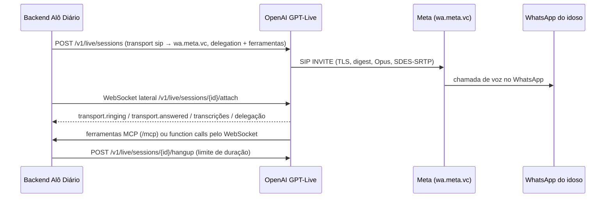

# Spike 0001 — Ligação pelo WhatsApp com a IA de voz da OpenAI (GPT-Live → SIP do WhatsApp)

- **Situação:** roteiro pronto, **ainda não executado** (depende de contas da Meta e da OpenAI).
- **Data:** 2026-10-17
- **Objetivo:** provar, antes de escrever o adaptador `ligacao/whatsapp/`, que uma sessão GPT-Live
  da OpenAI consegue ligar para o WhatsApp de uma pessoa **sem servidor de mídia nosso**, e
  confirmar os formatos reais de requisições e eventos (a API é nova e parte dos detalhes não está
  documentada).

## Como as peças se encaixam



## Pré-requisitos

**Meta (WhatsApp Business Calling):**
1. Número de **teste/sandbox** com Calling habilitado (o de produção exige limite de 2.000
   conversas/24h).
2. Configurar o SIP do número (`settings.calling.sip`: servidor e porta) e **habilitar SDES**
   (a OpenAI exige SDES-SRTP; o padrão da Meta é DTLS).
3. Obter a senha SIP gerada pela Meta: `GET /{phone-number-id}/settings?include_sip_credentials=true`.
4. Mandar o **pedido de permissão de chamada** para o celular de teste e aceitar no aparelho
   (vale 7 dias; limite de 1 pedido/dia e 2/semana por par empresa-usuário).

**OpenAI:**
1. Pedir a habilitação da **saída SIP** (outbound) para a organização: sem ela a criação da sessão
   com `transport.type: "sip"` e `destination` é recusada.
2. Chave da API com acesso ao modelo `gpt-live-1`.

## Requisições

Criação da sessão (formato da documentação da OpenAI, com os valores do WhatsApp):

```json
POST https://api.openai.com/v1/live/sessions
Authorization: Bearer $OPENAI_API_KEY

{
  "session": {
    "model": "gpt-live-1",
    "instructions": "<contexto montado pelo MontadorDeContexto: regras base + skills + perguntas>",
    "audio": { "output": { "voice": "marin" } },
    "delegation": {
      "type": "responses",
      "responses": {
        "model": "<modelo do backend>",
        "instructions": "Use as ferramentas para registrar respostas, recado e alertas.",
        "tools": [
          {
            "type": "mcp",
            "server_label": "alo_diario",
            "server_url": "https://<APP_PUBLIC_BASE_URL>/mcp",
            "headers": { "Authorization": "Bearer <token da ligação>" },
            "require_approval": "never"
          }
        ]
      }
    }
  },
  "transport": {
    "type": "sip",
    "destination": "+5511999990000",
    "trunk": {
      "provider_url": "sips:wa.meta.vc:5061",
      "auth": { "type": "digest", "username": "<número da empresa, normalizado>", "password": "<senha SIP da Meta>" },
      "caller_number": "+55<número da empresa>"
    }
  }
}
```

- WebSocket lateral: `wss://api.openai.com/v1/live/sessions/{session_id}/attach` (conectar logo
  após criar: só os eventos dos últimos 3 s são reenviados).
- Eventos de progresso: `transport.ringing`, `transport.answered`, `transport.failed`
  (`error.code`, `error.message`); fim: `session.closed`.
- Transcrição relatada pela comunidade (confirmar): `session.input_transcript.delta` (idoso) e
  `session.output_transcript.delta` (assistente).
- Desligar: `POST /v1/live/sessions/{session_id}/hangup` (corpo vazio).

## O que verificar e registrar

| # | Pergunta | Resultado |
|---|---|---|
| 1 | O INVITE da OpenAI é aceito pela Meta? (o domínio do `From` precisa bater com o servidor SIP configurado no número; ver se `wa.meta.vc` aceita a origem da OpenAI) | _a preencher_ |
| 2 | O celular toca como chamada do WhatsApp da empresa e o áudio funciona nos dois sentidos? | |
| 3 | Sem permissão de chamada, qual erro chega (`transport.failed` com o código 138006 da Meta?) | |
| 4 | Nomes e formato reais dos eventos de transcrição (idoso e assistente) | |
| 5 | Na delegação Responses, o próprio backend da OpenAI chama o nosso `/mcp` (com o header) ou a aplicação precisa devolver o resultado pelo WebSocket? | |
| 6 | Latência percebida entre a fala do idoso e a resposta, e depois de uma chamada de ferramenta | |
| 7 | Motivo do encerramento em `session.closed` / `transport.failed` (não atendeu, recusou, ocupado) | |
| 8 | Custo real por minuto na fatura (OpenAI + WhatsApp Calling) | |

## Decisão depois do spike

| Resultado | Caminho na Fase 12 |
|---|---|
| 1 e 2 funcionam | Adaptador `GatewayDeVozWhatsApp` direto (GPT-Live → SIP do WhatsApp), como no plano |
| INVITE recusado pela Meta | Mesma porta `GatewayDeVoz`, com um provedor de ponte (Twilio, LiveKit ou Voximplant) entre OpenAI e WhatsApp |
| 5: o Responses chama o `/mcp` | Ferramentas declaradas como MCP (implementação única em `mcp/`) |
| 5: a aplicação precisa responder | As mesmas ferramentas declaradas como *function tools*; o `MonitorDeSessaoLive` executa a ferramenta do `mcp/` e devolve `function_call_output` + `response.create` |

## Ferramenta de apoio

A classe de teste manual `FerramentaSpikeWhatsApp` (Fase 12, desligada no build; roda com
`-Dspike=true`) cria a sessão com os mesmos records do adaptador, conecta no WebSocket lateral e
grava todos os eventos em `target/spike/` para preencher a tabela acima.

## Fontes

- [Meta: WhatsApp Calling API](https://developers.facebook.com/documentation/business-messaging/whatsapp/calling)
- [Meta: configurações de chamada](https://developers.facebook.com/documentation/business-messaging/whatsapp/calling/call-settings/)
- [Meta: SIP](https://developers.facebook.com/documentation/business-messaging/whatsapp/calling/sip)
- [OpenAI: Realtime/GPT-Live por SIP](https://developers.openai.com/api/docs/guides/realtime-sip)
- [OpenAI: delegação e ferramentas no GPT-Live](https://developers.openai.com/api/docs/guides/live-delegation)
- [OpenAI: sessões GPT-Live](https://developers.openai.com/api/docs/guides/live-conversations)
